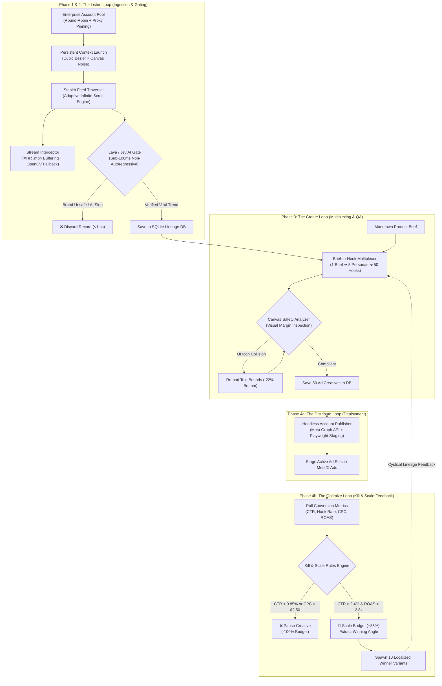
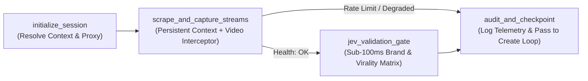
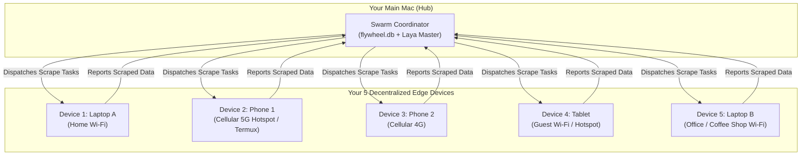
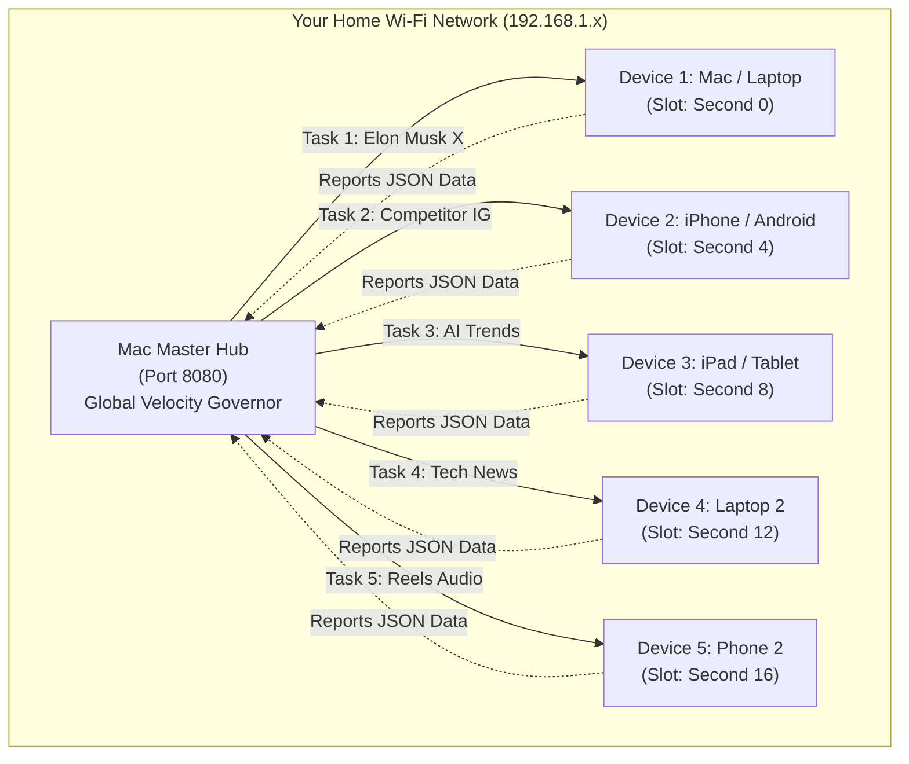
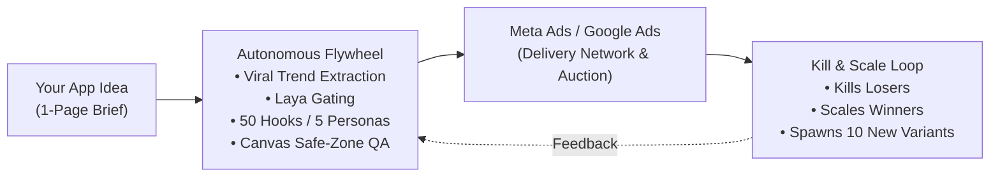
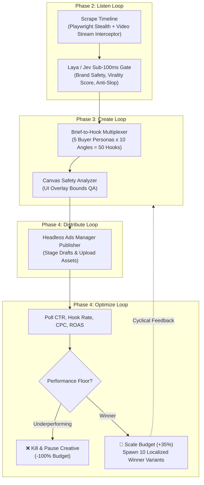

# 🗺️ System Architecture & Visual Flowcharts

This document compiles all visual architecture and operational diagrams generated for the **Autonomous Marketing Flywheel Agent** (InstaAgent Clone), covering the end-to-end cyclical pipeline, state machines, decentralized device swarms, and ad network interactions.

---

## Table of Contents
1. [Master 4-Phase Autonomous Marketing Flywheel](#1-master-4-phase-autonomous-marketing-flywheel)
2. [Phase 2: Ingestion Pipeline & LangGraph State Machine](#2-phase-2-ingestion-pipeline--langgraph-state-machine)
3. [Decentralized Mobile Edge Swarm (5 Physical Devices)](#3-decentralized-mobile-edge-swarm-5-physical-devices)
4. [Household Wi-Fi Staggered Velocity Governor (Same Wi-Fi Anti-Ban Protocol)](#4-household-wi-fi-staggered-velocity-governor-same-wi-fi-anti-ban-protocol)
5. [Autonomous Flywheel vs. Meta & Google Ads (Creative Factory vs. Delivery Truck)](#5-autonomous-flywheel-vs-meta--google-ads-creative-factory-vs-delivery-truck)
6. [Continuous Kill & Scale Optimization Loop](#6-continuous-kill--scale-optimization-loop)

---

## 1. Master 4-Phase Autonomous Marketing Flywheel

This diagram illustrates the complete, cyclical 4-phase architecture: continuous ingestion on X/Instagram, sub-100ms Laya/Jev gating, brief-to-hook multiplexing, pre-flight visual safety QA, programmatic distribution, and automated performance feedback.

---

## 2. Phase 2: Ingestion Pipeline & LangGraph State Machine

This diagram details the deterministic node transitions within `pipeline.py` during timeline scraping, handling network degradation and conditional routing to Laya/Jev decision gates.

---

## 3. Decentralized Mobile Edge Swarm (5 Physical Devices)

This diagram shows how 5 physical consumer devices (phones, tablets, laptops) act as a decentralized edge scraping cluster reporting back to the central Mac Hub without paid proxies ($0.00).

---

## 4. Household Wi-Fi Staggered Velocity Governor (Same Wi-Fi Anti-Ban Protocol)

When all 5 devices share the **same home Wi-Fi network** (sharing a single public external IP), the Central Hub coordinates a token-bucket slot schedule. This staggers requests across time slots to simulate an organic family browsing social apps simultaneously.

---

## 5. Autonomous Flywheel vs. Meta & Google Ads (Creative Factory vs. Delivery Truck)

This diagram illustrates why Meta and Google Ads are merely distribution/auction pipes, while our Autonomous Flywheel acts as the creative laboratory and intelligence layer that feeds them high-converting assets.

---

## 6. Continuous Kill & Scale Optimization Loop

This diagram illustrates the high-level circular feedback between scraping, multi-persona creation, headless ad deployment, metric polling, and automated variant generation.

