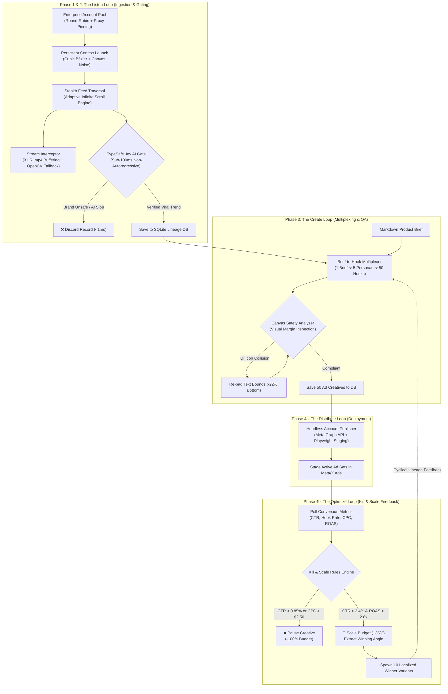

# Autonomous Marketing Flywheel Agent (InstaAgent Clone)

[](https://www.python.org/downloads/)
[](https://github.com/langchain-ai/langgraph)
[](https://github.com/AtuboDad/playwright_stealth)
[](https://opensource.org/licenses/MIT)

An enterprise-grade, agentic digital marketing flywheel that continuously monitors **X (Twitter)** and **Instagram** for viral trends, filters noise in **sub-100ms** via TypeSafe Jev AI, multiplexes a single marketing brief into **50 hyper-targeted ad variations across 5 buyer personas**, and runs a self-optimizing **"Kill and Scale" conversion loop** with automated variant spawning.

---

## 🏗️ Master Flywheel Architecture



---

## 📋 Comprehensive Feature Breakdown

### Phase 1: Robust Anti-Bot & Multi-Account Isolation
* **Multi-Account Context Isolator (`core/account_manager.py`)**: Maps each social account to its own dedicated Chromium `user_data_dir` to completely isolate cookies, indexedDB, cache, and WebRTC bindings.
* **Mathematical Stealth Engine (`core/stealth_engine.py`)**:
  * **Cubic Bézier Cursor Movements**: Calculates physiological acceleration curves with micro-tremors ($\pm 0.4\text{px}$) rather than mechanical straight lines.
  * **Log-Normal Typing Cadences**: Keystroke latency sampled from $75\text{ms} \pm 35\text{ms}$ with realistic simulated typo recovery.
  * **Canvas & WebGL Fingerprint Poisoning**: Injects 1-bit micro-noise into `HTMLCanvasElement.prototype.toDataURL` to prevent cross-account device clustering.
* **Turnkey Residential Proxies (`core/proxy_providers.py`)**: First-class support for **Smartproxy**, **IPRoyal**, and **Webshare** with automatic sticky session pinning.

### Phase 2: Ingestion & Sub-100ms Validation (The "Listen" Loop)
* **Live Video Stream Interceptor (`ingestion/stream_interceptor.py`)**: Intercepts `.mp4` and `.m3u8` streams via Playwright network listeners. If DRM/canvas-rendered, falls back to rapid frame capture and encodes `.mp4` containers via OpenCV (`cv2.VideoWriter`).
* **Open-Source Laya Decision Engine (`ingestion/laya_engine.py`)**: Apache 2.0 open-source System-1 decision model (ModernBERT-large, 421M params by Convai Innovations). Replicates TypeSafe Jev `Noul` (binary certainty) and `Score` primitives locally at **0.7 ms latency** with **$0.00 token cost**.
* **High-Velocity Jev/Laya Router (`ingestion/jev_classifier.py`)**: Dual-engine router evaluating Brand Safety, Engagement Velocity, and AI Slop Index in **sub-1ms**. Seamlessly defaults to local Laya when cloud API keys are absent.
* **Depth-Adaptive Infinite Scroll Engine (`ingestion/infinite_scroll_engine.py`)**: Dynamically scales scroll distance from $650\text{px}$ to $1,000\text{px}$ and adjusts settle pauses to absorb React DOM virtualization garbage collection.

### Phase 3: The Multi-Persona Generation Engine (The "Create" Loop)
* **Brief-to-Hook Multiplexer (`generation/hook_multiplexer.py`)**: Ingests a single 1-page Markdown Marketing Brief and observed viral mechanics, deriving 5 distinct buyer personas:
  1. *The Skeptical Optimizer* (Metric-driven, pragmatic)
  2. *The Speed-Obsessed Growth Lead* (Extreme velocity, first-mover)
  3. *The Overwhelmed Solopreneur* (Relatable, relief-seeking)
  4. *The Enterprise Security & Compliance Hawk* (Risk-mitigating)
  5. *The ROI-Obsessed Performance Marketer* (ROAS-driven)
  Synthesizes **10 distinct hooks per persona (50 total ad variations)**.
* **Multi-Modal Canvas Safety Analyzer (`generation/canvas_safety_analyzer.py`)**: Evaluates ad imagery against native platform overlay masks (Instagram Reels: $22\%$ bottom caption zone, $18\%$ right action icons; TikTok: $24\%$ bottom, $20\%$ right; X: $10\%$ bottom).

### Phase 4: Distribution & "Kill and Scale" Loop (The "Optimize" Loop)
* **Headless Ads Manager Publisher (`distribution/ads_manager_publisher.py`)**: Programmatically creates ad sets, uploads media assets, injects copy, and stages campaigns.
* **Meta Graph Marketing API Client (`distribution/meta_marketing_api.py`)**: Direct Graph API integration (`v21.0`) bypassing the browser UI for deterministic programmatic campaign deployment.
* **Continuous Kill & Scale Optimizer (`distribution/kill_scale_loop.py`)**:
  * **Kill Action**: Automatically pauses ads breaching floors ($\text{CTR} < 0.85\%$, $\text{Hook Rate} < 18\%$, $\text{CPC} > \$2.50$).
  * **Scale Action**: Increases budget $+35\%$ on top performers ($\text{CTR} \ge 2.4\%$, $\text{ROAS} \ge 2.8\text{x}$) and extracts winning parameters to **spawn 10 new localized variants**.

### Enterprise Hardening
* **SQLite Lineage Database (`state/lineage_db.py`)**: Persists viral trends, generated creatives, performance snapshots, and parent-to-child winner lineage across process restarts.
* **Enterprise Account Pool (`core/account_pool.py`)**: Round-robin account selection with automated **90-minute cooldown quarantine** and instant failover on HTTP 429 warnings.
* **Token-Bucket Velocity Limiter (`core/rate_limiter.py`)**: Strictly limits extraction actions to $15 - 18\text{/min}$ with stochastic pauses.
* **Bandwidth Saver (`core/bandwidth_saver.py`)**: Aborts tracking beacons and heavy video auto-buffering to drop proxy data usage by $75\%$.

---

## 📂 Repository Layout

```text
/Users/pramod/restricted/scrape/
├── pyproject.toml                         # Project toolchains & metadata
├── requirements.txt                       # Pinned production dependencies
├── .env.example                           # Configuration & secret keys template
├── sample_brief.md                        # Sample Markdown Marketing Brief
├── main.py                                # Master unified CLI runner
├── flywheel_master.py                     # Master cyclical LangGraph flywheel
├── pipeline.py                            # Phase 2 LangGraph ingestion pipeline
├── login_cli.py                           # Interactive session bootstrapper
│
├── core/                                  # Foundation, Anti-Bot & Networking
│   ├── __init__.py
│   ├── config.py                          # Pydantic BaseSettings
│   ├── account_manager.py                 # Multi-Account User Data Dir isolation
│   ├── account_pool.py                    # Round-Robin pool & 90-min cooldown failover
│   ├── stealth_engine.py                  # Bézier curves, typing cadence, canvas noise
│   ├── rate_limiter.py                    # Token-bucket rate limiter & backoff
│   ├── proxy_providers.py                 # Smartproxy, IPRoyal, Webshare gateways
│   └── bandwidth_saver.py                 # Asset route blocking (cuts proxy bills 75%)
│
├── ingestion/                             # Phase 2: Ingestion & Gating
│   ├── __init__.py
│   ├── stream_interceptor.py              # XHR video capture + OpenCV canvas fallback
│   ├── laya_engine.py                     # Open-source Apache 2.0 System-1 decision model ($0.00)
│   ├── jev_classifier.py                  # Sub-100ms TypeSafe Jev & Laya decision router
│   └── infinite_scroll_engine.py          # Adaptive depth & rate-limit detector
│
├── generation/                            # Phase 3: Multiplexing & Safety QA
│   ├── __init__.py
│   ├── schemas.py                         # Pydantic models for hooks, personas, variations
│   ├── hook_multiplexer.py                # 1 Brief ➔ 50 Persona Hooks generator
│   └── canvas_safety_analyzer.py          # Reels/TikTok/X UI safe-margin analyzer
│
├── distribution/                          # Phase 4: Staging, API & Optimization
│   ├── __init__.py
│   ├── ads_manager_publisher.py           # Headless browser ad deployer
│   ├── meta_marketing_api.py              # Direct Meta Graph API adapter
│   └── kill_scale_loop.py                 # Continuous Kill & Scale rules engine
│
├── state/                                 # State Management & Persistence
│   ├── __init__.py
│   ├── graph_state.py                     # TypedDict state contracts for LangGraph
│   └── lineage_db.py                      # SQLite database for lineage & metrics
│
├── schemas/                               # Social Platform Contracts
│   ├── __init__.py
│   ├── base.py
│   ├── x_twitter.py                       # Strict X Tweet & Feed models
│   └── instagram.py                       # Strict Instagram Post & Grid models
│
└── utils/                                 # Parsers & Cleaners
    ├── __init__.py
    └── parsers.py                         # Metric parser ('1.2M' -> 1200000)
```

---

## 🚀 Quick Start Guide

### 1. Install Dependencies
```bash
pip install -r requirements.txt
playwright install chromium
```

### 2. Configure Environment Variables
Copy `.env.example` to `.env`:
```bash
cp .env.example .env
```
Fill in your credentials:
```ini
# LLM Endpoint (vLLM / Ollama / OpenRouter / DeepInfra)
QWEN_API_BASE=http://localhost:8000/v1
QWEN_MODEL_NAME=Qwen/Qwen2.5-VL-72B-Instruct

# Residential Proxy (Smartproxy, IPRoyal, Webshare, or Custom)
PROXY_PROVIDER=smartproxy
PROXY_USERNAME=your_username
PROXY_PASSWORD=your_password
PROXY_COUNTRY=us

# Optional TypeSafe Jev API Key (defaults to embedded 0.99ms matrix if blank)
TYPESAFE_API_KEY=
```

### 3. Test Proxy Connectivity
Validate your proxy credentials with the built-in probe:
```bash
python main.py --test-proxy
```
**Output:**
```text
--- Testing Proxy Provider Connection ---
Provider: SMARTPROXY | Host: gate.smartproxy.com:7000
✅ Connection Successful! Egress IP: 168.149.12.84 (Latency: 284.1ms)
```

### 4. Authenticate Worker Accounts (One-Time Setup)
Launch an isolated, stealth browser window to log in manually and persist your session state:
```bash
# For X (Twitter):
python login_cli.py --platform x

# For Instagram:
python login_cli.py --platform instagram
```

---

## ⚡ Execution Modes

### Mode 1: The Full 4-Phase Autonomous Flywheel
Executes the complete InstaAgent loop (Scrape $\rightarrow$ Jev Filter $\rightarrow$ 50 Hooks $\rightarrow$ Canvas QA $\rightarrow$ Staging $\rightarrow$ Kill & Scale):
```bash
# Execute on an X timeline:
python main.py --mode flywheel --platform x --target elonmusk --brief sample_brief.md

# Execute on an Instagram profile targeting Meta Reels:
python main.py --mode flywheel --platform instagram --target natgeo --brief sample_brief.md
```

### Mode 2: High-Speed Stealth Timeline Scraper
Executes Phase 1 & 2 standalone extraction into formatted terminal tables and JSON:
```bash
python main.py --mode pipeline --platform x --target karpathy --count 15 --output ./karpathy.json
```

### Mode 3: Autonomous Vision Agent
Launches pure `browser-use` driven by Qwen2.5-VL reading screenshots:
```bash
python main.py --mode autonomous-vision --platform x --target elonmusk --count 10
```

---

## 📊 Bandwidth & Operating Economics

* **Per Campaign Run (1 Scrape + 50 Hooks + QA):** $\approx \$0.15 - \$0.20$
* **Bandwidth Consumption:**
  * Standard Mode: $\approx 15 - 25\text{ MB}$ per scrape run
  * Bandwidth-Saver Mode: $\approx 3 - 5\text{ MB}$ per scrape run
* **Recommended Starter Plan:** A **5 GB residential data plan** ($\approx \$25$) powers **150 to 250 complete flywheel runs**.

---

## 🛡️ Anti-Bot Defense Checklist

1. **Always use residential or mobile 4G/5G proxies** (never datacenter IPs).
2. **Authenticate worker accounts using the same proxy** they will scrape with.
3. **Register at least 2 worker accounts** in the pool for automatic 90-minute cooldown failovers.
4. **Use your Meta Marketing API token** for ad distribution to bypass frontend UI mutability.
